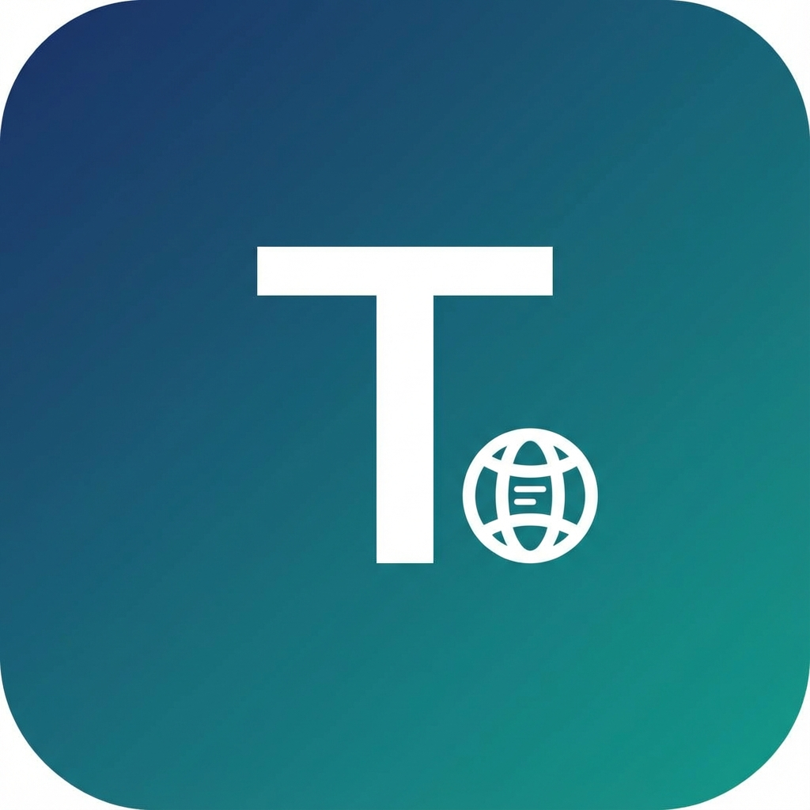
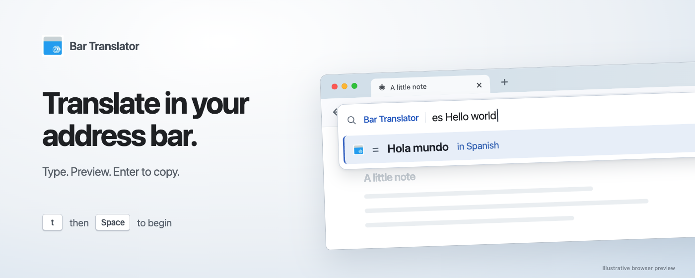

# Bar Translator



Translate a word or phrase right from your browser's address bar, while keeping your page in view. Take a look at the result, then copy it if you like.

[](https://chromewebstore.google.com/detail/Bar%20Translator/edigfnmbafijmbnplkmddhemkghjkhno)

Add it to desktop Chrome from the Chrome Web Store. You can also use it in desktop Firefox or Microsoft Edge with a [local build](USAGE.md#browser-builds).

## Start translating

1. Settings open in a new tab after installation. Pick your languages, then select **Grant access** for Google Web or add another translation service.
2. Head to the address bar with **Ctrl+L** on Windows/Linux or **Cmd+L** on macOS. Type `t`, then press **Space**.
3. Type a phrase and look for the translation in the address bar suggestions.

For example, `t fr Hello world` translates “Hello world” to French. Leave out `fr` to use your saved target language. You can also choose **Auto-detect** for the source language.

💡 To copy a finished translation, turn on **Enter to copy** in settings, allow clipboard access, and press **Enter** when the result is ready. There's more on shortcuts, browser differences, and provider setup in the [user guide](USAGE.md).

## Make it yours

- Switch languages for one phrase with a short code. Your saved defaults stay just as they are.
- Use Google Web or Lingva, connect a DeepL account, or add a managed or self-hosted LibreTranslate server.
- Give your DeepL and LibreTranslate setups their own names and choose the order to try them. If one can't translate, the next may receive the same text.

## Privacy you can understand

Your translation requests go directly to the providers you choose. Bar Translator doesn't collect usage analytics.

Your settings and API keys are stored on your device by default. If you choose **Sync**, your whole setup, including saved credentials, is shared through your browser account. The [privacy and storage guide](USAGE.md#permissions-and-privacy) has the details.

> [!WARNING]
> API keys, tokens, and other credentials are stored as plain text in your browser profile. Unauthorized access to that profile could expose them.

## Build from source

To try the code, you'll need Node.js 24.15+ (24.x) and pnpm 12.14.0:

```bash
git clone https://github.com/oovz/bar-translator.git
cd bar-translator
pnpm install --frozen-lockfile
pnpm dev
```

See the [browser setup instructions](USAGE.md#browser-builds) to install a build and [CONTRIBUTING.md](CONTRIBUTING.md) for development and test commands.
