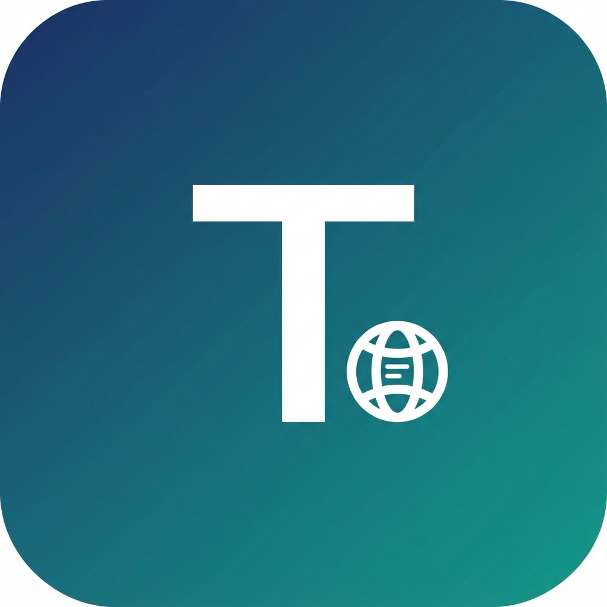
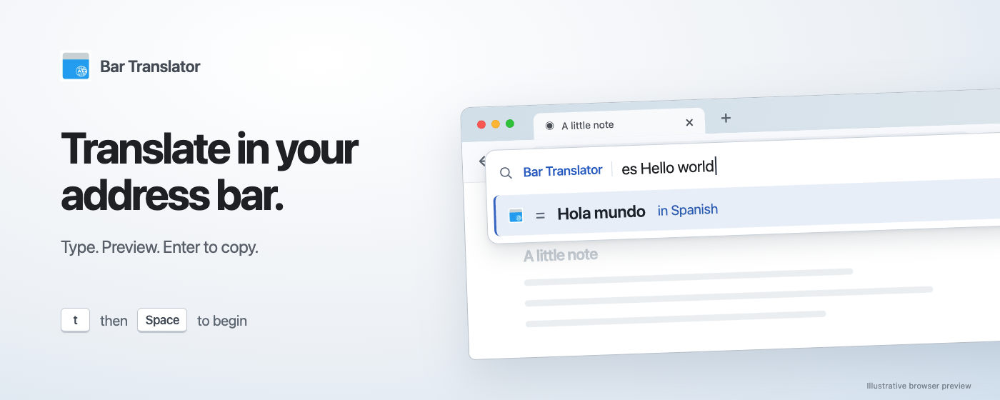

# Bar Translator

Translate in your browser's address bar and keep your page in view. Type your text, read the translation, and optionally press Enter to copy it.

[](https://chromewebstore.google.com/detail/Bar%20Translator/edigfnmbafijmbnplkmddhemkghjkhno)

[User guide](docs/usage.md)

Use Bar Translator on desktop **Chrome, Firefox, and Microsoft Edge**. See the [installation guide](docs/usage.md#browser-builds) for local browser builds.



## Translate with the languages you use

1. Open settings to choose your source and target languages, activate your preferred translation services, and grant access. Settings open when you first install the extension.
2. Focus the address bar with **Ctrl+L** on Windows/Linux or **Cmd+L** on macOS. Type **`t`**, then **Space**.
3. Enter your text. The preview uses your saved languages.

For example, `t Hello world` translates “Hello world” to your saved target language. Choose **Auto-detect** as the source language if you want the provider to identify it.

Enable **Enter to copy** in settings to copy a completed translation with Enter. Optional language prefixes let you change languages for one translation; the [user guide](docs/usage.md#language-shortcuts) has examples.

## Small by design

- Read translations while your current page stays open.
- Preview a translation before choosing to copy it.
- Choose which translation services receive your text and the order in which they are tried.
- Allow provider and clipboard access as you enable those features.

## Privacy you can understand

Translation requests go directly to the providers you choose. Bar Translator collects no usage analytics.

Your settings and API keys are stored locally by default. Choose **Sync** in settings to share your whole setup, including credentials, through your browser account. Read the [privacy and storage guide](docs/usage.md#permissions-and-privacy) for details.

> [!WARNING]
> API keys, tokens, and other credentials are stored as plain text in your browser profile. Unauthorized access to that profile could expose them.

## Choose your translation providers

Choose from **Google Web**, **Lingva**, **DeepL**, and **LibreTranslate** in settings.

## Run locally

Use Node.js 24.15+ (24.x) and pnpm 12.14.0:

```bash
git clone https://github.com/oovz/bar-translator.git
cd bar-translator
pnpm install
pnpm dev
```

See the [browser setup instructions](docs/usage.md#browser-builds) to build and install each supported desktop target.
